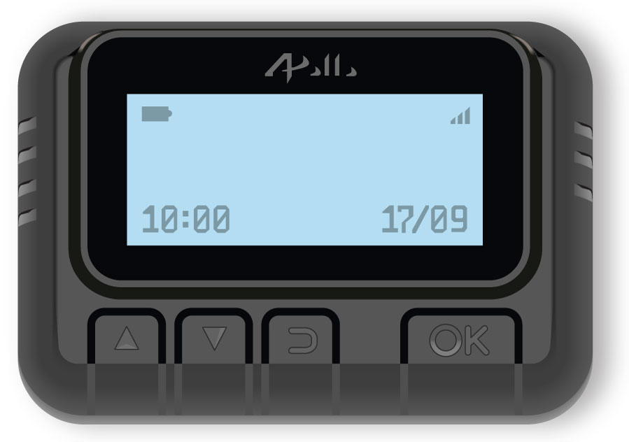

# node_modules

analyse d'une scène de crime

---

# Video attaque

- 

<!--
Les notes de présentation vont ici.
-->

---

# Générique

---
layout: scene-investigator
handle: '@pseudo'
badge:
  Nom: Gianella
  Prénom: Théo
  Unité: Zenika
  Grade: '[rôle]'
---

# Théo Gianella

[rôle] · Zenika

- [expérience ou rôle actuel]
- [projet, communauté ou sujet]
- [pourquoi ce sujet vous concerne]

---

# Attaque de supply chain

  <Diamond v-click="1" class="h-[300px]" />
  <ph-arrow-left-bold v-click="5" class="col-start-2 row-start-1 row-span-2 text-[200px] text-[var(--hud-ink)]" />
  <CardboardBoxes v-click="3" class="h-[300px]" />
  <Padlock v-click="2" class="h-[360px]" />
  <Padlock v-click="4" open class="h-[360px]" />

<!-- Explication de ce qu'est une attaque de supply chain, partant du général pour l'appliquer à l'informatique -> compromettre des dépendances pour toucher des cibles plus sécurisées ou plus vastes. 

Slide maillon faible-->

---

# Supply chain matérielle

  <!-- both examples share the same cell, so their cards sit at the same place -->
  

    <!-- example 1: IBM Selectric (clicks 1-3) -->
    

      <SubjectCard
        v-click="[1, 4]"
        compact
        class="open-center w-[640px]"
        header="Dossier 7694"
        flag="■ Classé"
        name="IBM Selectric"
        meta="1970-1984"
        :fields="[
          { label: 'Commanditaire', value: 'KGB' },
          { label: 'Cible', value: 'Ambassade états-unienne' },
          { label: 'Méthode', value: 'Keylogger', alert: true },
          { label: 'Découverte', value: '1984' },
        ]"
      >
        <template #mugshot>
          <ph-bug-light class="text-[56px]" />
        </template>
      </SubjectCard>
      
    

    <!-- example 2: pager (clicks 4-5), hidden from click 6 -->
    

      <SubjectCard
        v-click="[4, 6]"
        compact
        class="open-center w-[640px]"
        style="--enter-delay: 0.4s"
        header="Dossier 2533"
        flag="■ Classé"
        name="Bippeurs"
        meta="2024"
        :fields="[
          { label: 'Commanditaire', value: 'Israël' },
          { label: 'Cible', value: 'Hezbollah' },
          { label: 'Méthode', value: 'Explosifs', alert: true },
          { label: 'Victimes', value: '42 morts, >3500 blessés' },
        ]"
      >
        <template #mugshot>
          <ph-bug-light class="text-[56px]" />
        </template>
      </SubjectCard>
      
    

  

  
  <Connector v-click="[3, 4]" from=".typewriter" to=".bug" />
  <!-- final section: scarcity, the state, military objectives (clicks 7-9, after an empty step at click 6) -->
  

    <Hourglass v-click="7" class="h-[400px]" />
    <GovernmentBuilding v-click="8" class="h-[400px]" />
    <Target v-click="9" class="h-[400px]" />
  

---

# Supply chain logicielle

  <Iceberg v-click="1" class="h-[400px]" />
  <CakeSlice v-click="2" class="h-[400px]" />
  <MoneyBags v-click="3" class="h-[400px]" />

<!-- Différences avec la supply chain matérielle, la supply chain logicielle est beaucoup plus étendue et d'une nature différente (exécution de code, donc récupération d'info ou d'argent, alors que dans le monde réel). Le coût d'entrée est beaucoup moins élevé et les cibles beaucoup plus nombreuses, ça peut être monétisé. -->

---

# Un écosystème qui repose sur l'open source

<!-- five overlapping chart windows, like windows on a desktop; each one opens above the previous ones.
     The area under the title is about 716px tall: keep top + window height (about 430–450px at 1000px wide) under it -->

  <ChartWindow
    v-click
    class="open-center absolute left-0 top-0 w-[1040px]"
    title="Paquets disponibles sur npm"
    source="Source : modulecounts.com (archive web) et replicate.npmjs.com, au 1er janvier puis en octobre 2026"
    type="line"
    :data="[[2012, 0.006], [2013, 0.02], [2014, 0.053], [2015, 0.115], [2016, 0.222], [2017, 0.374], [2018, 0.57], [2019, 0.751], [2020, 1.167], [2021, 1.482], [2022, 1.833], [2023, 2.23], [2024, 2.645], [2026.78, 4.499]]"
    :max="5" :step="1" unit=" M" :decimals="1" last-partial
  />
  <ChartWindow
    v-click
    class="open-center absolute left-[620px] top-[280px] w-[1000px]"
    title="Téléchargements sur npm par an"
    source="Source : api.npmjs.org — * 2026 : du 1er janvier au 12 octobre"
    :data="[[2015, 21], [2016, 59], [2017, 130], [2018, 295], [2019, 599], [2020, 1054], [2021, 1596], [2022, 2182], [2023, 2641], [2024, 3079], [2025, 4182], [2026, 6303]]"
    :max="7000" :step="1000" unit=" Md" last-partial
  />
  <ChartWindow
    v-click
    class="open-center absolute left-[1210px] top-0 w-[460px]"
    title="Projets contenant de l'open source"
    source="Source : Black Duck, rapport OSSRA 2026"
    figure="98 %"
    caption="des applications auditées contiennent de l'open source"
  />
  <ChartWindow
    v-click
    class="open-center absolute left-[80px] top-[260px] w-[980px]"
    title="Part de l'open source dans le code des applications"
    source="Source : Black Duck (Synopsys), rapports OSSRA 2017–2025, par année de rapport (n.d. : non disponible)"
    :data="[[2017, 36], [2018, 57], [2019, 60], [2020, 70], [2021, null], [2022, 78], [2023, 76], [2024, 77], [2025, 70]]"
    :max="100" :step="25" unit=" %"
  />
  <ChartWindow
    v-click
    class="open-center absolute left-[400px] top-[120px] w-[960px]"
    title="Composants open source par application"
    source="Source : Black Duck (Synopsys), rapports OSSRA 2017–2026, moyenne par année de rapport (n.d. : non disponible)"
    :data="[[2017, 147], [2018, 257], [2019, 298], [2020, 445], [2021, null], [2022, 528], [2023, 595], [2024, 526], [2025, 911], [2026, 1180]]"
    :max="1200" :step="300"
  />

<!-- Particularité de l'industrie logicielle, une dépendance immense à l'open source. Deux aspects, 90% du code en moyenne vient de l'open source donc il y a une surface d'attaque énorme. Et l'open source est par définition ouvert, donc très vulnérable (ça veut pas dire qu'il est impossible à sécuriser, mais c'est beaucoup plus difficile). Combinaison d'une supply chain très vulnérable et énorme. En comparaison dans le monde matériel, c'est comme si il y a avait des fournisseurs gratuits de matières premières et que n'importe qui pouvait visiter les usines de ces fournisseurs. -->

---

# De l'exploitation à l'attaque

<!-- two dependency trees in windows, the second one opening over the first, offset down and to the right;
     upstream package at the top, applications at the bottom; clicks 1–3 on the first, 4–6 on the second -->

  <AppWindow v-click="1" class="open-center col-start-1 row-start-1 relative -left-[64px] -top-[56px] w-[960px]" title="Failles involontaires">
    <VulnTree class="tree" mode="flaw" :at="2" pkg="lodash@4.17.11" project="ma-boutique" />
  </AppWindow>
  <AppWindow v-click="4" class="open-center col-start-1 row-start-1 relative left-[64px] top-[56px] w-[960px]" title="Injection de code malveillant">
    <VulnTree class="tree" mode="poison" :at="5" pkg="debug@4.4.2" />
  </AppWindow>

<!-- L'open source est un énorme bienfait pour le développement mais à un prix en termes de sécurité. Il n'y a pas une autorité centrale qui écrit le code, mais une multiplicité d'auteurs, or on retombe sur le maillon faible. Si tout est interdépendant, le système est aussi sûr que son maillon le plus faible.

Historiquement, la vulnérabilité est plutôt vue comme venant de failles de sécurité non corrigées qui peuvent être exploitées, mais en 2017 apparaît un nouveau modèle. Directement injecter les vulnérabilités dans les dépendances pour les exploiter. -->
---

# Des attaques de plus en plus fréquentes

<!-- four overlapping windows, like on the previous slide: attacks get more frequent (malicious packages),
     then bigger (organisations reached, per attack, share of breaches).
     The area under the title is about 716px tall: keep top + window height under it -->

  <ChartWindow
    v-click
    class="open-center absolute left-0 top-0 w-[1000px]"
    title="Attaques open source recensées depuis 2015, en cumul"
    source="Source : Sonatype, State of the Software Supply Chain 2020 (2015 à mai 2020) et 2026 (2021–2025), « Next generation software supply chain attacks »"
    type="line"
    :data="[[2015, 20], [2017, 63], [2018, 142], [2019, 380], [2020, 1152], [2021, 12000], [2022, 89000], [2023, 245032], [2024, 704102], [2025, 1233219]]"
    :max="1400000" :step="200000"
    :rescale="{ until: 2020, max: 1200, step: 200 }"
  />
  <ChartWindow
    v-click
    class="open-center absolute left-[620px] top-[220px] w-[960px]"
    title="Organisations touchées via un fournisseur, par an"
    source="Source : Identity Theft Resource Center, rapports annuels 2023 et 2025 (violations de données notifiées aux États-Unis)"
    :data="[[2018, 101], [2019, 232], [2020, 694], [2021, 558], [2022, 1748], [2023, 2767], [2024, 660], [2025, 1252]]"
    :max="3000" :step="1000"
  />
  <ChartWindow
    v-click
    class="open-center absolute left-[1180px] top-0 w-[480px]"
    title="Organisations par attaque"
    source="Source : Identity Theft Resource Center"
    figure="9,4"
    caption="touchées en moyenne par chaque attaque en 2025, contre 1,2 en 2018"
  />
  <ChartWindow
    v-click
    class="open-center absolute left-[80px] top-[320px] w-[520px]"
    title="Violations impliquant un tiers"
    source="Source : Verizon, DBIR 2025"
    figure="30 %"
    caption="des violations de données, deux fois plus que l'année précédente"
  />

<!-- Conclusion, avec la croissance de l'industrie logicielle et son imbrication, les attaques augmentent aussi, jusqu'à une vague d'attaques en 2024. -->

---
transition: view-transition
---

# Eté 2025 : le tournant

<!-- proportional timeline from the launch of npm (events in data/attacks.ts);
     the click singles out event-stream, whose name morphs into the title of the next slide -->
<ZoomTimeline :events="attacks" zoom-from="2025-07-01" zoom-label="été 2025" highlight="event-stream" :highlight-at="1" morph="event-stream" />

---
transition: view-transition
---

<!-- the title receives the event-stream label of the timeline (the label uses the title font, so that
     the two overlap exactly while it moves); its highlight frame grows to the edges of the slide with the
     slide inside it, as if the focus expanded to the whole slide, and comes back on the next slide -->
<h1>event-stream</h1>

<FocusTarget morph="event-stream" />

---

# Eté 2025 : le tournant

<!-- back from event-stream: same timeline, shown at once with event-stream singled out;
     the click zooms on the summer 2025 pile -->
<ZoomTimeline :events="attacks" zoom-from="2025-07-01" zoom-label="été 2025" highlight="event-stream" morph="event-stream" :reveal="false" :zoom="1" />

<!-- Focus sur la vague d'attaques de l'été 2025. Les attaques vont croissant, mais à partir de l'été 2025, c'est la folie, le système devient rentable et on a des attaques de toute part. C'est le moment où tout un écosystème qui s'est développé hyper vite mais de manière fragile se fait attaquer. Fin d'une époque de la naïveté.-->
---

# Shai-Hulud : next gen

<!-- Reprise de la slide avec les deux arbres de paquets et on montre l'auto génération-->

---

# Pourquoi NPM ?

<!-- Cible facile, peu de contrôle, extreêmement populaire. Montrer un graphique qui compare les tailles entre les différents registres -->

---

# Ecosystème JS/NPM

<!--  Présentation de l'écosystème npm, un registre centralisé où tout le monde peut poser ses dépendances, côté publication et côté consommation, présentation de registres miroirs et des outils de gestion de dépendances côté projet -->